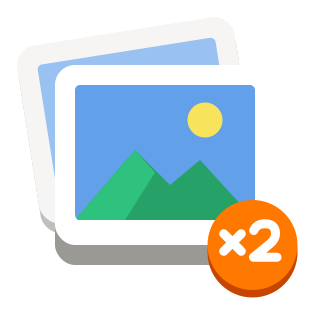
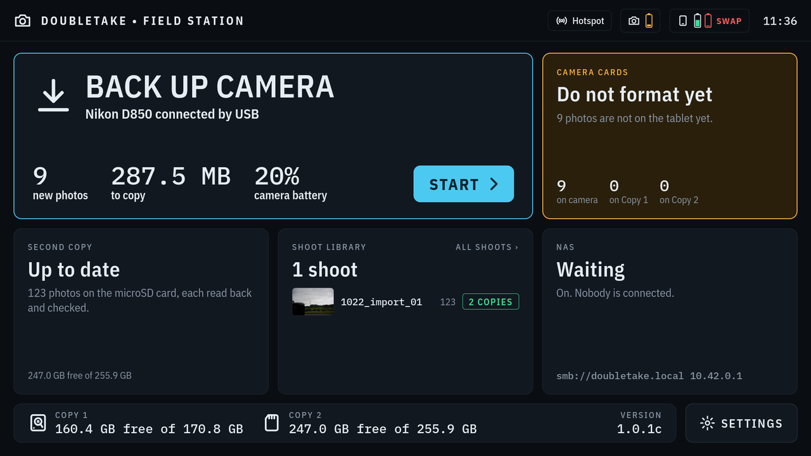
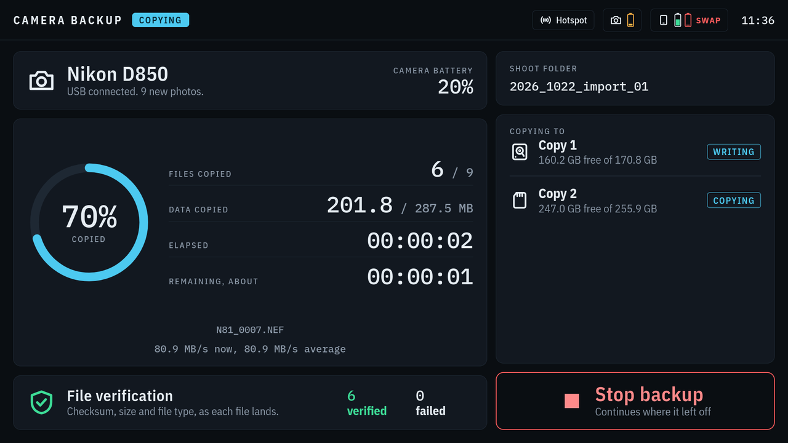
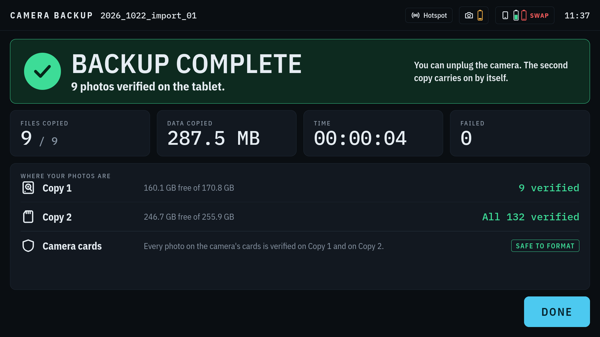
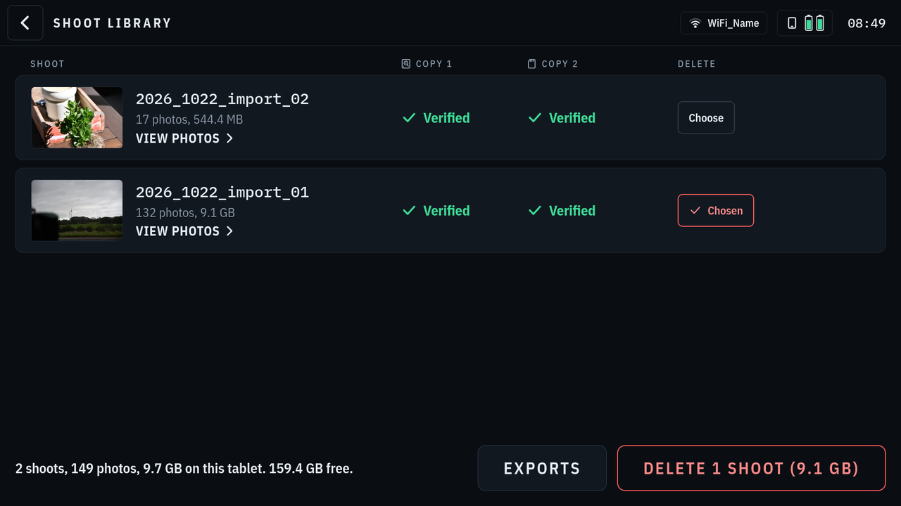
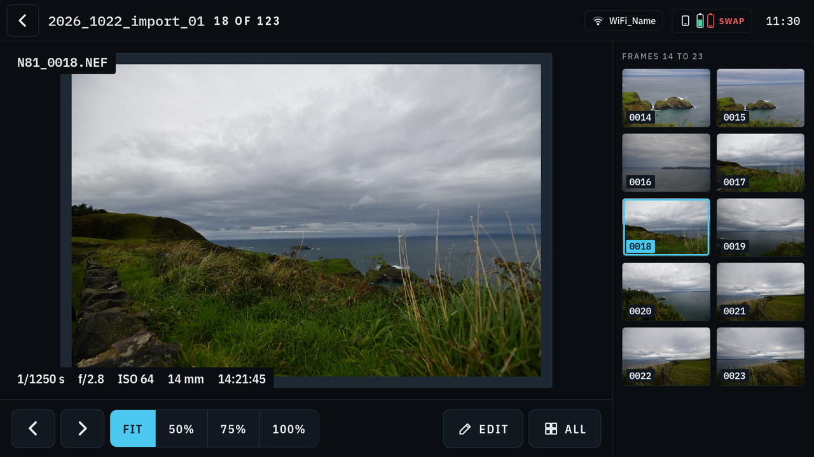
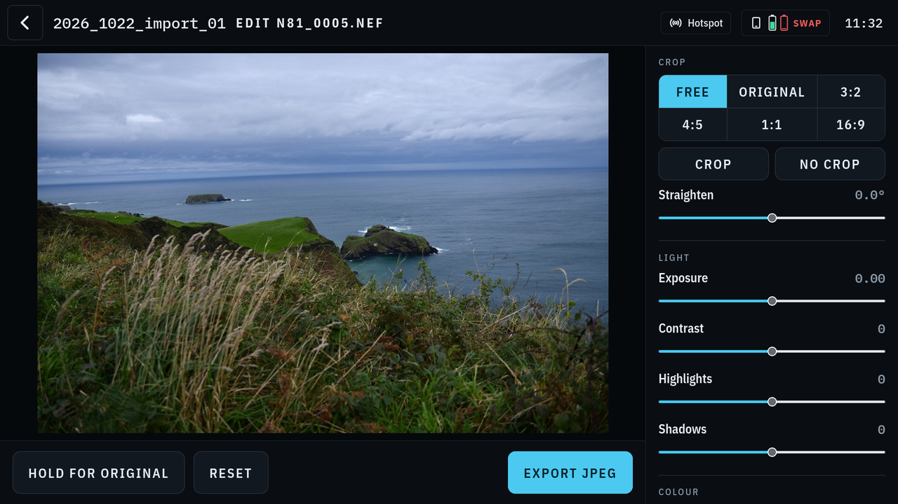
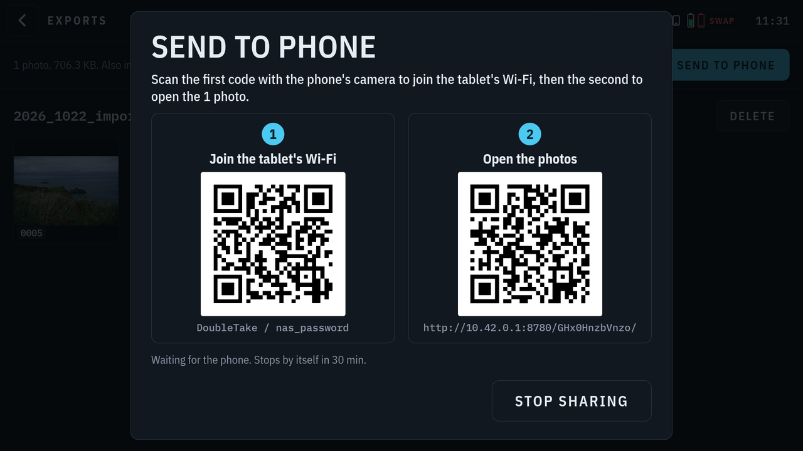
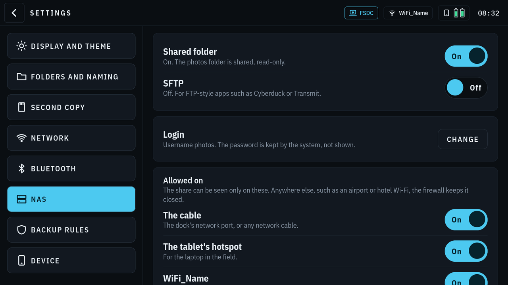

<p align="center"></p>

# DoubleTake Field Station

**Two verified copies of every photo, before you leave the field.**

**A touch-screen photo backup station for a rugged Linux tablet.** Plug in your camera,
tap Start, and DoubleTake copies every new photo to the tablet, checks each file,
makes a second verified copy on a microSD card, and tells you when it is truly safe to
format your camera's cards. Back home, it shares the photos with your computer as a
read-only network drive, so any photo app on your editing workstation can import straight from it.

This project is a demonstration of what becomes possible when a idea and AI-assistance development come together. If you have an idea for a personal tool and think you lack the technical background to build it — this project is proof that you might be wrong. Fun Fact: Claude AI even helped write this README and most of the supporting documentation ;-) Like the rest of the project, it's not perfect—but hopefully it's useful. If you spot anything that needs improvement, feel free to update it. 

Thanks and have a great day!



Built for working photographers in the field — airshows, ramps, sports, travel — who
want their cards emptied and their photos in two places before they leave, without
carrying a laptop. Developed and tested with a Nikon D850 and an Insta360 Ace Pro 2 on a
Dell Latitude 7220 Rugged Extreme running Rocky Linux 9 and Red Hat Enterprise Linux 9.

> **Built for the Dell Latitude 7220 Rugged Extreme** (12.5-inch screen, 1920 × 1080),
> running Rocky Linux 9 or Red Hat Enterprise Linux 9. It may run on other tablets, but the
> screens were drawn for the 7220's, and some features are made for it: its P1–P3 keys (a
> one-touch backup and the tablet's status), its volume and brightness keys, and its two
> hot-swap batteries. To use something else, fork it and adapt it.

## Why

A memory card is a single point of failure. DoubleTake's job is simple to state and
strict in practice:

- **Your camera's cards are never touched.** The app only reads from the camera. It never
  deletes, formats or changes anything on the camera's cards. You format them in the
  camera, when DoubleTake says it is safe.
- **"Safe to format" means it.** The Camera Cards tile turns green only when every photo
  on the camera is verified on Copy 1 (the tablet) *and* on Copy 2. Nothing else counts.
  Until then it says how many photos are still waiting, and why.
- **Every copy is checked.** Each photo gets a SHA-256 checksum as it comes off the
  camera. The microSD copy is written, flushed, read back from the card and compared
  before it counts.
- **Interruptions are safe.** Unplug the camera, pull the card, or close the app part-way:
  the next run carries on where it stopped, and nothing half-written looks complete.

## Features

### Backup
- **Finds the camera by itself** when it is plugged in, reads its cards and shows how many
  photos are new, how much data, and the camera's battery.
- **Copies only what is new**, into a folder of its own for each import, named by the day,
  the shoot name and a number: `2026_1015_ramp_sunset_01`, or `2026_1015_import_01` when no
  name is typed. Names are lower case, with `_` for spaces. Name the shoot with one tap or
  type one on the built-in keyboard.
- **Live progress**: files and data copied, time left, speed, and a running count of
  verified and failed files.
- **Shows the camera by name**, with its brand: Nikon D850, Canon EOS-1D Mark II,
  Sony α7R V (Sony's model codes are translated to the names on the camera).
- **Never writes to the camera.** Its cards and its settings, clock included, are left
  exactly as they are: DoubleTake reads the photos and the battery level, nothing else.
- **Updates in Maintenance mode**: every 30, 60 or 90 days (or off), or sooner for a security fix, a
  terminal offers the system's updates and a newer DoubleTake, checked against its
  checksums, and installs them only if you say so.
- **The tablet's own keys** (Dell Latitude 7220): P1 is a one-touch backup, P2 turns the red
  theme on and off, P3 shows the tablet's status: the version, the photos on Copy 1 and
  Copy 2, and each battery's charge and health.
- **Backup beeps:** one as a backup starts, two when it is done, three low ones when it
  needs a look, so a backup can be followed without looking.
- **The tablet's status** at a glance (P3, or Settings, Device): photos on Copy 1 and
  Copy 2, the space left on each, and each battery's charge, health and charge cycles.
- **Unattended backup** (optional): plug in the camera and, after a 10-second countdown you
  can cancel, the new photos are copied by themselves into the next numbered
  import (`2026_1013_import_01`, `_02`). The beeps say when it is done, and a dark screen in between
  lights again when the camera comes.
- **What to copy**: RAW only, RAW + JPEG, or everything with videos. Whatever is left on the
  camera is listed, and the cards are never called safe to format while it is there. With
  RAW only, the JPEG a camera makes beside each RAW (some cannot shoot RAW alone) is used
  for the RAW's picture and not kept, and does not count as left behind.
- **Cameras that plug in as a drive**, such as the Insta360 Ace Pro 2 in U-Disk mode, are
  read like any other camera. So is **a camera's card in a card reader**, or in the
  tablet's own slot: anything with a DCIM folder is a camera's card, only ever read, and
  never offered as the second copy or to be erased.
- **Battery watch**: the top bar shows each battery, the camera's and every one in the
  tablet, as a small upright icon filled to its level: green above 30%, amber to 20%, red
  below, flashing at 5%. Tap them for the exact numbers and each battery's health.
  **Below 10%, DoubleTake will not start a copy**: with the camera at 10% or below, or
  the tablet at 10% or below and off its charger. A copy that gets there stops cleanly after
  the photo it is on and carries on where it stopped after a battery swap. **Swap** shows
  next to a battery that should be swapped.





### Second copy on a microSD card or a USB drive
- **microSD card or USB drive (beta)**, chosen in the settings. A USB drive need not stay
  plugged in: photos backed up while it is away are copied when it is back, and the camera
  cards are not called safe to format until they are.
- **Runs in the background** from the tablet's drive, starting once a tenth of the camera
  copy is done and following a little behind it, so it finishes soon after. The camera can
  be unplugged as soon as its copy is done. Pause and resume from the home screen.
- **A drive of its own**: a new microSD card or USB drive is erased and
  kept for DoubleTake alone (one exFAT partition, readable on any computer), after three
  checks and typing AGREE. From then on it is recognised and used silently.
- **Read back and compared** file by file, and `doubletake verify --card` re-reads the
  whole card, which also catches counterfeit cards that are smaller than they claim.

### Shoot library and photo viewer
- Every shoot with a thumbnail, its size, and where its copies are: Copy 1 (the tablet)
  and Copy 2.
- **Delete** shoots once they are on your editing workstation: choose one or several, then
  Delete, once. A shoot is kept for a day after it was copied, in case something went wrong.
- **Photo viewer** with swipe, a filmstrip and exposure details. **Zoom to 50%, 75% or 100%**
  to check focus: double-tap a spot to zoom there, drag to look around.
- **Sort** a shoot by capture time or by name, either way round (oldest first by default).
- **Rename photos** from a pattern such as `{date}_{shoot}_{seq}` → `2026-10-11_ramp_sunset_0001.NEF`,
  as they are imported or later for a whole shoot. The microSD copy is renamed to match, a
  RAW and its JPEG keep the same name, and the camera's own names stay in the records so
  nothing is ever copied twice.

| | |
|---|---|
|  |  |

### Quick edits and sharing from the field
- **Edit** any photo: crop (free, original, 3:2, 4:5, 1:1, 16:9), straighten, exposure,
  contrast, highlights, shadows, white balance, saturation, sharpening and black and white,
  with a live preview and a hold-to-compare button. The RAW file is never changed; edits are
  saved separately and can be changed or reset later. Real editing stays on your editing workstation.
- **Export JPEG** at full size, 2048 px or 1080 px, one photo or every edited photo in a shoot.
  Exports keep the camera model and capture time, and live in their own Exports folder.
- **Send to phone**: the screen shows two QR codes. One joins the tablet's hotspot, the
  other opens a download page with the photos. The page is only on the hotspot, needs a
  fresh random code, is read-only, and stops by itself after 30 minutes.
- **Copy to USB**: copies the exports to a stick, each one read back and checked, then ejects it.
- Exports are also in the NAS share, for the computer back home.

| | |
|---|---|
|  |  |

### The tablet as a NAS
- **Read-only network share** of the photos for Mac, Windows and Linux (SMB), plus
  **SFTP** for apps like Cyberduck, Transmit and FileZilla. Nothing on your computer can
  change or delete the tablet's photos.
- **Its own username and password**, separate from the tablet's login.
- **Trusted networks only**: the share opens on the cable (the dock's network port), the
  tablet's own hotspot, and the Wi-Fi networks you switch on. On any other network, such
  as airport or hotel Wi-Fi, the firewall keeps it closed — even when the app is not
  running. The screens warn you, with a one-tap fix, when the share is on but the network
  you are on is not trusted.
- **NAS tile** on the home screen: which computers are connected, the file being read and
  how fast.



### Network and Bluetooth
- **Wi-Fi**: join networks from the screens, with passwords on the built-in keyboard.
- **Hotspot**: the tablet makes its own Wi-Fi network, so a laptop in the field can join it
  directly with no router.
- **FSDC, Field Station Direct Connect**: plug a network cable straight from the tablet to a laptop
  (through USB network adapters if needed). When no router answers, the tablet links to the
  laptop by itself, the way two computers do with no network, and the NAS opens at
  `smb://<tablet>.local`. The fastest way to import a large shoot.
- **Bluetooth**: pair a keyboard, mouse or the like, with any passkey shown on screen.
- Network status icons in the top bar, next to the tablet's and the camera's batteries.

### Made for a tablet in the field
- **Full-screen touch interface** with large targets, in two looks: **Classic**, bold and
  high-contrast, with four themes including **Night Red** to protect night vision; and
  **Cockpit**, calmer, with thin lines and large numbers, in Cockpit Dark, Cockpit Light and
  Cockpit Red.
- **Start at power-on** (optional): the tablet logs in by itself and opens DoubleTake
  full screen, and the screen will not lock or go dark during a long copy.
- **DoubleTake boot screen** (optional): the DoubleTake icon inside a turning orange and
  green ring while the tablet starts and shuts down, in place of the system's own screen.
  Where the firmware shows its maker's logo (the Dell logo on the 7220), the boot screen
  takes over from it in the same place and at the same size.
- **Screen flicker fix** (Intel graphics): one switch turns off the two power savings that
  make some Intel screens flicker on Linux.
- **The volume and brightness keys** work in DoubleTake only too, with a small level bar.
- **DoubleTake password** (optional, recommended with DoubleTake only): a password of
  its own, separate from the tablet's, for the ways out of DoubleTake (Maintenance mode,
  Exit, switching DoubleTake only off) and the jobs that cannot be undone (Format, Reset,
  Erase). Backups and everything else, every day, never ask for it.
  If it is forgotten, it is cleared from a text console with the tablet's own login; see
  the [user guide](docs/USER-GUIDE.md#the-doubletake-password).
- **DoubleTake only** (optional): the tablet starts straight into DoubleTake with no
  desktop behind it, like an appliance, using the GNOME Kiosk session that comes with
  RHEL and Fedora. If the screens ever close, they open again by themselves. The full
  desktop is one tap away, as a maintenance visit that ends at the next restart. Restart
  and Shut down are in the screens too.
- **Device tools**: format the microSD card, reset settings, erase everything (with a
  typed confirmation while anything is not yet imported), exit to the desktop.
- **Everything also works from the command line** — backup, mirror, verify, speed test
  and a self-check (`doubletake doctor`).

## Requirements

- **A Linux tablet or laptop** with the GNOME desktop and Firefox. Runs on:

  | System | |
  | --- | --- |
  | Rocky Linux 9 | supported, tested on the Dell 7220 |
  | Red Hat Enterprise Linux 9 | supported, tested on the Dell 7220 (and an earlier Dell 5175) |
  | AlmaLinux 9 | expected to work, as a rebuild of Red Hat 9 |
  | Fedora | best effort: it runs, but your mileage may vary |
  | Anything else | fork it and adapt it |

  Recommended: Rocky Linux 9. Red Hat Enterprise Linux 9 works the same (register it
  first). Fedora changes quickly, and some parts behave differently there: it gets its own
  package, but not the same testing.

  When installing the OS, choose **Workstation** or **Server with GUI** as the base
  environment. A Minimal install has no desktop, and DoubleTake needs one.
- **A camera that connects over USB** with the standard picture-transfer protocol (PTP).
  DoubleTake uses [libgphoto2](http://www.gphoto.org/), which supports most current
  cameras. Tested with a Nikon D850 over USB, and an Insta360 Ace Pro 2 as a drive; other
  cameras are expected to work but have not been tested yet.
- **A microSD card** in the tablet, or a USB drive, for the second copy (recommended, not
  required).
- For the NAS: a network cable, the tablet's hotspot, or a trusted Wi-Fi network.

## Install

### The package

Download the package for your system from the latest release, and `install.sh` with it,
into one folder. Then, as the tablet's own user:

```bash
bash install.sh
```

It checks the system, asks for your password once, registers a Red Hat system if it is
not yet, installs the package, and then asks the setup questions right there in the
terminal, one at a time: the DoubleTake password, what to copy, Copy 2, the built-in NAS
and where it opens, the hotspot, and how the tablet starts. Enter keeps what is shown. It
ends by restarting the tablet, and DoubleTake comes up.

`doubletake setup` asks the questions again any time, and on the screens **Settings,
Device, Reconfigure** walks through the same choices with a finger. Upgrading: run
`install.sh` next to the new package. Photos, records and settings are kept.

### From the source: setup.sh

```bash
git clone https://github.com/nickmackowski/doubleTAKE.git
cd doubleTAKE
./setup.sh
```

Setup asks before changing anything, and asks for your password once. It installs any
missing system packages, a private Python environment with the camera library, the
program in `~/DoubleTake`, the `doubletake` command and an entry in the app list. It
also sets up the NAS (off until you switch it on) and Bluetooth, if the tablet has it.

Then, with the camera plugged in and switched on:

```bash
doubletake doctor     # checks that everything is ready
doubletake gui        # opens the touch screens, full screen
```

**Upgrading from the source:** press Exit, pull or download the new version, and run `./setup.sh` again.
Upgrades replace only the program. Your photos (`~/Pictures/DoubleTake`) and records
(`~/Documents/DoubleTake`) are never touched.

## Documentation

- [User guide](docs/USER-GUIDE.md) — every screen and setting, the commands, where files go,
  and how to uninstall
- [How it works](docs/HOW-IT-WORKS.md) — verification, the safe-to-format rule, the
  architecture and the security model
- [Testing](docs/TESTING.md) — a step-by-step first test with a camera, and the automated tests
- [Changelog](CHANGELOG.md)
- [Security](SECURITY.md) — how to report a problem, and what DoubleTake does to stay safe
- [History](docs/HISTORY.md) — how it grew, from a command-line backup engine to DoubleTake, version by version

## Roadmap

- **Camera upload over Wi-Fi/Ethernet**: receive photos as you shoot from cameras that can
  upload to an FTP/SFTP server.
- **Import progress**: show how far a computer has got in reading each shoot through the
  NAS, as a hint before deleting it.
- **Remote backup** to a home server.
- **An iPad version**: welcome. It would be a new app in Swift rather than a port of this
  one, as the iPad has no Linux to run it on; the design and the rules carry over.

## Development

The engine is Python 3.9+ with the standard library, plus
[python-gphoto2](https://github.com/jim-easterbrook/python-gphoto2) and
[Pillow](https://python-pillow.org/). The screens are plain HTML, CSS and JavaScript
served to the tablet itself. System changes that need root go through one small,
self-contained helper (`system/doubletake-helper`) with a fixed list of checked jobs.

The tests need no camera, card or root: cameras, cards, NetworkManager, Bluetooth and
the helper are all stood in for.

```bash
python3 -m unittest discover -s tests -v
```

```
doubletake/        the engine, the web server and the screens (doubletake/web)
doubletake/sources the camera (libgphoto2) and folder sources
system/              the root helper and the boot screen
packaging/           the package (RPM): its spec, launcher, build script and install.sh
tests/               automated tests and stand-ins
docs/                user guide, design notes, testing guide, screenshots
setup.sh             installer and upgrader from the source
```

## License

[MIT](LICENSE) © 2026 Nick Mackowski

The screens use the Barlow, Barlow Condensed and IBM Plex Mono fonts, included under the
SIL Open Font License (see `doubletake/web/fonts/`). Camera access is by libgphoto2
and python-gphoto2, under their own licenses (LGPL and GPL). They are not in the source;
setup.sh installs them, and the packages bring them, with their licenses, in
`/usr/lib/doubletake`. The el9 package also brings Pillow (HPND) and segno (BSD).

To build the packages: `packaging/build-rpm.sh` (needs rpmbuild and pip).
